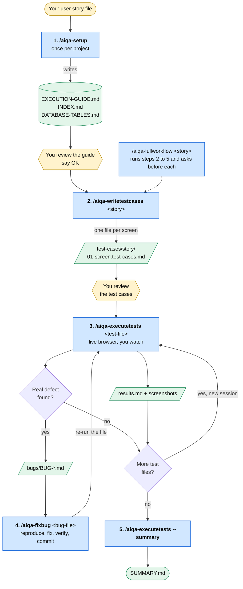
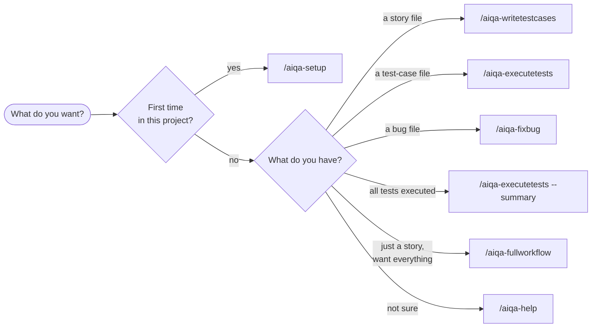
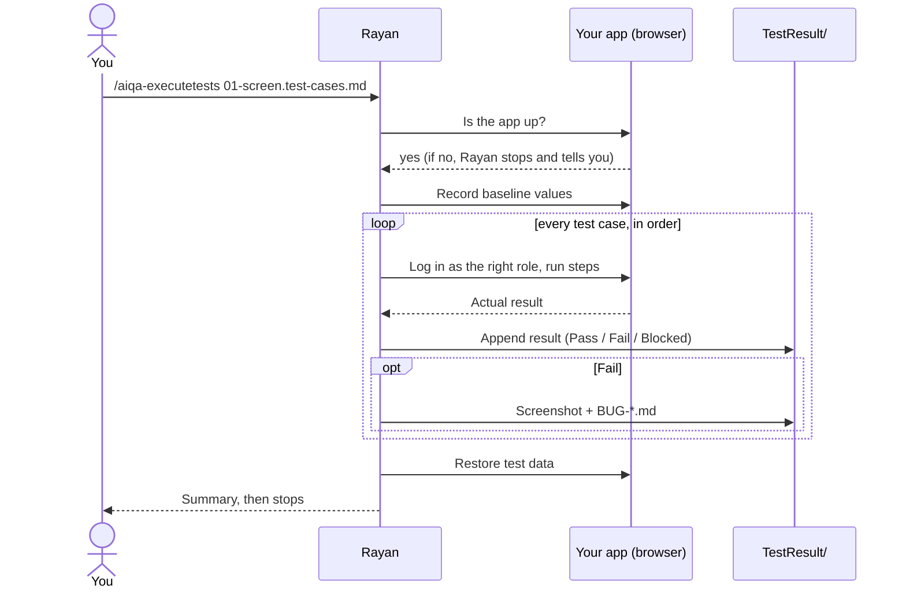
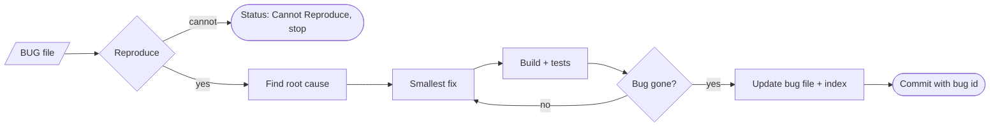

# AI QA Framework

> A **Senior AI QA Engineer** for any project. Give it a user story. It writes test cases, runs them in a browser you can watch, files bug reports, and can fix the bugs.

[](https://www.npmjs.com/package/ai-qa-framework)
[](LICENSE)
[](https://nodejs.org)

---

## Contents

1. [How it works](#1-how-it-works)
2. [Before you start](#2-before-you-start)
3. [Install](#3-install)
4. [Connect the Playwright browser](#4-connect-the-playwright-browser)
5. [Walkthrough: first story in 5 steps](#5-walkthrough-first-story-in-5-steps)
6. [Command reference](#6-command-reference)
7. [What you get (output folders)](#7-what-you-get-output-folders)
8. [Safety rules](#8-safety-rules)
9. [Configuration](#9-configuration)
10. [Tips and troubleshooting](#10-tips-and-troubleshooting)
11. [Upgrading from v2](#11-upgrading-from-v2)
12. [Project layout](#12-project-layout)

---

## 1. How it works

The framework installs a QA agent named **Rayan** into your AI assistant (Claude Code, Cursor, GitHub Copilot, Windsurf). Rayan works from **3 prompts**:

| Prompt | Command | Input | Output |
|---|---|---|---|
| **Write** test cases | `/aiqa-writetestcases` | a story file | test-case Markdown files, one per screen |
| **Execute** tests | `/aiqa-executetests` | one test-case file | results, screenshots, bug files |
| **Fix** a bug | `/aiqa-fixbug` | one bug file | code fix, verified, committed |

Two helpers support them:

| Command | Use |
|---|---|
| `/aiqa-setup` | Run **once per project**. Collects facts about your app (URL, login, test users, database) and writes the guide the 3 prompts read. |
| `/aiqa-fullworkflow` | Chains write → execute → fix and asks you before each step. |

### The big picture



**Legend:** yellow = you, blue = command Rayan runs, green = file created.

### Which command do I need?



Key ideas:

- **Tests run live.** Rayan drives a real browser through the Playwright MCP server. **The browser is visible by default.** You watch every click.
- **No generated test scripts, no Excel.** Test cases and results are Markdown files you can read, review and commit.
- **Self-review after every step.** Setup, write, execute and fix each end with a mandatory review pass: Rayan re-reads its own output against a checklist, fixes the issues it finds (max 2 rounds) and reports *found / fixed / open*. Example: missing AC coverage or invented UI texts in test cases, false Fails or incomplete bug files in results, unrelated changes in a bug-fix diff.
- **One unit per session.** One story, one test file, one bug per run. Each command stops after its summary. This keeps the context small and the results reliable.
- **Reads your code first.** Texts, element ids, routes and roles in the test cases come from your source, not from guesses.

---

## 2. Before you start

You need:

- **Node.js 18+** and npm
- An AI assistant: Claude Code, Cursor, GitHub Copilot or Windsurf
- The **Playwright MCP server** connected to that assistant ([step 4](#4-connect-the-playwright-browser))
- Your application **running** (Rayan never starts it unless you allow it)
- Story files (Markdown) that describe the feature and its acceptance criteria (ACs)
- Optional: read-only database access, so Rayan can find test users and check data

---

## 3. Install

In your project folder:

```bash
npx ai-qa-framework install
```

The installer asks for project name, language, test mode and AI tools, then copies the framework into `./ai-qa-framework/` and registers the `/aiqa-*` commands for your tool(s).

Non-interactive: `npx ai-qa-framework install --yes --tools claude-code`

If the commands do not show up, run `/aiqa-init` inside your AI assistant. It is safe to re-run.

---

## 4. Connect the Playwright browser

Executing tests needs the Playwright MCP server. Example for Claude Code:

```bash
claude mcp add playwright -- npx @playwright/mcp@latest
```

Other tools: add the same server in their MCP settings (`npx @playwright/mcp@latest`).

- The MCP browser opens **headed (visible)** unless the server was started with `--headless`. If you do not see a browser during execution, remove that flag. Rayan will also tell you.
- If you **do not want to see the browser**, say "run headless", pass `--headless`, or set `show_browser: false` in `config.yaml`.

---

## 5. Walkthrough: first story in 5 steps

Open your AI assistant in the project and follow along. Paths below are examples.

### Step 1 — Setup (once)

```text
/aiqa-setup
```

Rayan:
1. Detects your stack and routes.
2. Asks only what it cannot find: app URL, login method, UI language/direction, source folders, build and test commands, database (read-only).
3. Finds test users for the roles in your stories (database lookup with SELECT only, or you type them).
4. Writes three files in `TestResult/`:
   - `EXECUTION-GUIDE.md` — environment, login, test users, placeholders, data rules, result and bug formats
   - `INDEX.md` — list of test-case files with status, plus known gaps
   - `DATABASE-TABLES.md` — tables Rayan may query (read-only)
5. **Shows you the guide and waits.** Read it. Fix wrong URLs, users or data rules. Say "OK" when it is right.

Anything marked `<TODO>` must be filled before you execute tests.

### Step 2 — Write the test cases

```text
/aiqa-writetestcases docs/stories/2-1-orders.md
```

Rayan reads the story, the requirement it implements, and the source files in the story's file list. Then it writes one file per screen:

```
TestResult/test-cases/2-1-orders/01-orders-list.test-cases.md
TestResult/test-cases/2-1-orders/02-order-form.test-cases.md
```

Each file contains: header (route, roles, ACs covered) · **known gaps** between story and code · **deferred / out of scope** items · exact UI texts · test data needed · case tables (access, functional, validation, data, negative, security, export, UI/accessibility, regression) · Playwright notes (selectors, modals, waits).

**Review these files before executing.** Edit anything wrong. Case ids look like `TC-21-OR-001`.

### Step 3 — Execute one test file

```text
/aiqa-executetests TestResult/test-cases/2-1-orders/01-orders-list.test-cases.md
```



Rayan:
1. Checks that the app (and database) answer. If down, it stops and tells you.
2. Records baseline values before touching anything.
3. Opens the **visible** browser and runs **every case in order**, logging in as the right role for each one.
4. Writes the results file **after each case** (a crash loses nothing). Re-run the same command to resume.
5. Takes a screenshot for every failure and key pass.
6. Creates one bug file per real defect (after checking `BUGS-INDEX.md` for duplicates).
7. Restores test data, then prints a summary: Pass / Fail / Blocked / Not Run, blocked reasons, bugs created. **Then it stops.** Run the command again for the next file.

Case results:

| Result | Meaning |
|---|---|
| Pass | Behaviour matches expected result |
| Fail | Behaviour differs. Evidence saved. Bug filed if real defect |
| Blocked | Cannot run: missing role/data/approval, or element not found after 2 attempts. Reason is written |
| Not Run | Skipped on purpose |

Rayan asks you only before **global changes** (for example activating another plan or creating a user).

### Step 4 — Fix a bug (optional)

```text
/aiqa-fixbug TestResult/test-results/bugs/BUG-2-1-001-duplicate-error-under-both-fields.md
```



Rayan reproduces the bug first. If it cannot, it sets the status to **Cannot Reproduce** and stops. Otherwise it finds the root cause, makes the smallest fix, runs your build and tests, repeats the reproduction, updates the bug file (Status = Fixed, Fix Notes) and the index, and commits with the bug id in the message.

Then re-run the test file that found the bug to confirm.

### Step 5 — Final summary

After all test files are executed:

```text
/aiqa-executetests --summary
```

Rayan checks (read-only) that baseline values are restored and no test rows remain, then writes `TestResult/test-results/SUMMARY.md` with totals per story and file, bugs by severity, confirmed gaps and a recommendation.

### Shortcut: do it all

```text
/aiqa-fullworkflow docs/stories/2-1-orders.md
```

Runs steps 2 → 5 and asks "continue?" between steps.

---

## 6. Command reference

| Command | Arguments | Notes |
|---|---|---|
| `/aiqa-setup` | — | Run first. Re-run to refresh the guide. Existing filled values are kept |
| `/aiqa-writetestcases` | `<story-file>` | Several files of one feature = one story folder (named after the first) |
| `/aiqa-executetests` | `<test-case-file>` | One file per run. Resumes if results exist |
| | `--headless` | Hide the browser. Only when you ask |
| | `--summary` | Final restore check + `SUMMARY.md` |
| `/aiqa-fixbug` | `<bug-file>` | One bug per run |
| `/aiqa-fullworkflow` | `<story-file>` | Chain with confirmations |
| `/aiqa-help` | — | Rayan's menu |
| `/aiqa-init` | — | Register commands for your AI tools |
| `/aiqa-reset` | — | Delete generated outputs (asks `YES`). Keeps the guide unless you say so |
| `/aiqa-listskills`, `/aiqa-listworkflows` | — | List what is installed |
| `/aiqa-chat` | — | Ask Rayan any QA question |
| `/aiqa-terse [lite\|full\|ultra\|off]` | level | Shorter chat replies (saves tokens). Files are never shortened |
| `/aiqa-tokenstats [--all] [--since 7d]` | — | Token usage and savings |
| `/aiqa-terse-help` | — | Terse mode card |

You can also paste a prompt from `reusable-prompts/` into any new AI session. Replace the path on the first line.

---

## 7. What you get (output folders)

```
TestResult/
├── EXECUTION-GUIDE.md          project facts (from /aiqa-setup)
├── INDEX.md                    test files, status, known gaps
├── DATABASE-TABLES.md          schema notes for read-only checks
├── test-cases/
│   └── <story>/
│       └── 01-<screen>.test-cases.md
└── test-results/
    ├── <story>/
    │   ├── 01-<screen>.results.md
    │   └── screenshots/TC-21-OR-001.png
    ├── bugs/
    │   ├── BUGS-INDEX.md
    │   └── BUG-2-1-001-<short-title>.md
    └── SUMMARY.md
```

**Test-case file ids:** `TC-<epic><story>-<SCREEN>-<number>`, for example `TC-21-OR-001` = story 2.1, orders screen, case 1.

**Bug file:** status, severity (Critical / High / Medium / Low), steps to reproduce, expected vs actual, evidence, suspected code location (`file:line`), and Fix Notes (filled by `/aiqa-fixbug`).

Everything is plain Markdown. Commit the folders you want to keep.

---

## 8. Safety rules

Built into the execute prompt:

- Results are real. Rayan never invents Pass/Fail.
- **No changes** to application code, config, migrations or job settings while testing.
- Data changes only **through the UI**, on **test-prefixed rows** (for example names starting with `99` or `E2E`), exactly as your guide allows. The baseline is restored at the end of each file.
- Database access is **SELECT only**. No INSERT/UPDATE/DELETE/DDL.
- Passwords are never written to files. They show as `****`.
- Rayan does not start, build or restart your app unless you set `allow_ai_restart: true` and a `restart_command`.
- Global changes (activate/deactivate a plan, create users, toggle jobs) need your approval.
- **Known gaps** and **deferred** items listed in the test file are recorded, not filed as new bugs.

`/aiqa-fixbug` is the only command that edits your source code, and only for the one bug you name.

---

## 9. Configuration

`ai-qa-framework/config.yaml` (edit any time; read at runtime):

```yaml
# Identity and language
project_name: "MyProject"
user_name: "Your Name"
communication_language: English
document_output_language: English

# Output
output_folder: "{project-root}/ai-qa-framework/TestResult"

# Browser (Playwright MCP)
show_browser: true            # false = headless (only if you do not want to watch)
viewport: "1920x1080"
max_locate_attempts: 2        # failed attempts to find an element, then Blocked

# Target application (filled by /aiqa-setup)
app_url: "https://localhost:5001"
ui_language: "English"
ui_direction: ltr             # rtl for Arabic/Hebrew UIs
source_roots: ["src"]         # code folders read for bug locations and fixes
ignored_paths: ["legacy"]     # never read or touched
code_standards_files: ["CODE_STANDARDS.md"]
tech_stack: "ASP.NET Core 8 MVC"
build_command: "dotnet build"
test_command: "dotnet test"
restart_command: ""           # empty = Rayan never restarts the app
allow_ai_restart: false

# Quality gate
min_pass_rate: 95

# Database (optional, read-only lookups)
db_connection_string: ""
db_users_table: "users"

# Filled by /aiqa-setup
test_users: []

# Token saving
terse_mode: full              # off | lite | full | ultra
```

---

## 10. Tips and troubleshooting

| Problem | Fix |
|---|---|
| "EXECUTION-GUIDE.md missing / has `<TODO>`" | Run `/aiqa-setup` and fill the TODO items |
| `/aiqa-*` commands do not appear | Run `/aiqa-init`, restart the AI tool |
| No browser window during execution | The Playwright MCP server runs headless. Remove `--headless` from its start command |
| Browser opens but Rayan cannot click | Check the "Playwright notes" in the test file. Rayan marks the case **Blocked** after 2 attempts. Fix the note and re-run the file (it resumes) |
| "App is down" and nothing runs | Start your app yourself, then re-run. Or set `restart_command` and `allow_ai_restart: true` |
| Many cases Blocked for a missing role | Add a user for that role in the guide, or approve account creation when Rayan asks |
| Test data left behind after a crash | Re-run the same file (it cleans up at the end), or run `/aiqa-executetests --summary` to list leftovers |
| Same bug found twice | Rayan checks `BUGS-INDEX.md` and adds the new case id to the existing bug |
| Replies feel too long/short | `/aiqa-terse lite` / `ultra` / `off`. Generated files are never shortened |

Good habits:

- Review test-case files before executing them. Wrong expectations make false failures.
- Execute files in the order given in `INDEX.md` (a later file may need data from an earlier one).
- Start a **new session** for each test file, bug or story.
- Keep stories small and specific. One screen = one file.

---

## 11. Upgrading from v2

v3 replaces the 9-phase pipeline (analyze story → XLSX → generated Playwright specs → test data → run → bug analysis → report → fix) with the 3 prompts.

| v2 command | v3 |
|---|---|
| `/aiqa-analyzeproject`, `/aiqa-fetchtestusers` | `/aiqa-setup` |
| `/aiqa-analyzestory`, `/aiqa-generatetestcases` | `/aiqa-writetestcases` |
| `/aiqa-generatee2e`, `/aiqa-generatetestdata`, `/aiqa-runtests` | `/aiqa-executetests` |
| `/aiqa-analyzebugs`, `/aiqa-generatereport` | `/aiqa-executetests` (bug files + `SUMMARY.md`) |
| `/aiqa-fixbugs` | `/aiqa-fixbug` (one bug per run) |
| `/aiqa-fullworkflow` | `/aiqa-fullworkflow` (chains the 3 prompts) |
| `*-validate`, security, accessibility, regression, autonomous | Removed. Security, accessibility and regression are now case sections in test-case files |

Removed outputs: XLSX files, generated Playwright page objects/specs, JSON test-data files, HTML reports.

To upgrade an existing install:

```bash
npx ai-qa-framework upgrade
```

Then run `/aiqa-init`. It adds the new command files but **does not delete old ones**. Delete the old `aiqa-*` stubs in `.claude/commands/`, `.github/prompts/`, `.cursor/rules/` or `.windsurf/rules/` that no longer exist in the list above. Re-run `/aiqa-setup` once to create the guide files.

---

## 12. Project layout

```
ai-qa-framework/
├── agents/            qae.md (Rayan), qae-compact.md, qae-init.md, terse-rules.md
├── reusable-prompts/  write-test-cases / execute-tests / fix-bug   ← the 3 prompts
├── skills/            project-setup, project-analysis, write-test-cases, execute-tests, fix-bug
├── workflows/         setup, write-test-cases, execute-tests, fix-bug, full-workflow
├── templates/         EXECUTION-GUIDE, INDEX, DATABASE-TABLES, test-cases, results,
│                      bug-report, BUGS-INDEX, SUMMARY
├── commands/          registry.yaml
├── core/              orchestrator.mjs, token tools
├── project-detectors/ adapters/ rules/ hooks/ _config/ _memory/
├── config.yaml        your settings
└── TestResult/        generated outputs
```

Supported stacks (detection): Angular, React, Vue, Blazor · .NET, Node.js, Java, Python · SQL Server, PostgreSQL, MySQL, MongoDB, SQLite · JWT, OAuth, cookie, basic auth.

---

## License

[MIT](LICENSE) © 2026 Ahmed Al Wakeel
